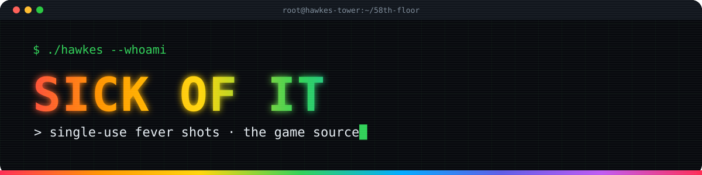

<div align="center">



<a href="https://sickofitgame.com"></a> <a href="https://github.com/jgriffith3433/sickofitgame-unity"></a> <a href="https://github.com/jgriffith3433/sickofitgame-unity"></a> <a href="https://hawkesbiomedical.com"></a>

### 🌈 **SINGLE-USE FEVER SHOTS · THE GAME SOURCE** 🌈

</div>


## ⚡ `$ cat WHOAMI`

> **A sarcastic nobody chases the Overlord up 1,000 floors of Hell. Hell is repetition, so rewind is the hero's power.**

```diff
+ repo     sickofitgame-unity
+ live     https://sickofitgame.com
+ stack    Unity 6 · WebGL · the game as JSON
+ part of  the Hawkes universe: 9 products, 3 engines, one H
```


## 🧬 **THE H** · the whole machine on one screen

```
   ░░ WHO ASKS STUDIO ░░                         ░░ WHO ASKS GEN ░░
   the owner · testers · the clock               editors · game tools · the portal
              │                                               │
   ┏━━━━━━━━━━▼━━━━━━━━━━┓      jobs ━━━━━▶      ┏━━━━━━━━━━━━▼━━━━━━━━━━━━┓
   ┃   HAWKES  STUDIO    ┃                       ┃       HAWKES  GEN       ┃
   ┃   decides           ┃      ◀━━━━━ evidence  ┃       makes             ┃
   ┃   tasks · judges    ┃                       ┃   queue · router · lib  ┃
   ┗━━━━━━━━━━┳━━━━━━━━━━┛                       ┗━━━━━━━━━━━━┳━━━━━━━━━━━━┛
              ▼                                               ▼
   ░ six AI harnesses ░                          ░ rented GPUs · CPUs · browsers ░
   commits ▶ dev ▶ beta ▶ main ▶ 🌐 live          files kept forever, by their content
```

**One side decides, one side makes, and they meet in exactly one place.** Files never cross the bar, only their ids. Nothing ships until evidence about that exact commit has come back.


## 💊 **THE PRODUCT LINE** · presented as medicine, played as games

| Product | Sold as | Live | Repo |
|:--|:--|:--|:--|
| Hawkes Biomedical | *the parent company* | [hawkesbiomedical.com](https://hawkesbiomedical.com) | [`hawkesbiomedical`](https://github.com/jgriffith3433/hawkesbiomedical) |
| PH Origins | *pH balance* | [phorigins.com](https://phorigins.com) | [`phoriginswebsite`](https://github.com/jgriffith3433/phoriginswebsite) |
| **➤ Sick Of It** | *single-use fever shots* | [sickofitgame.com](https://sickofitgame.com) | [`sickofitgamewebsite`](https://github.com/jgriffith3433/sickofitgamewebsite) |
| Dose Of Destruction | *cytotoxic dose* | [doseofdestruction.com](https://doseofdestruction.com) | [`doseofdestructionwebsite`](https://github.com/jgriffith3433/doseofdestructionwebsite) |
| Yooba Land | *hyporexia support* | [yoobalandgame.com](https://yoobalandgame.com) | [`YoobaLandGame`](https://github.com/jgriffith3433/YoobaLandGame) |
| I Can Be | *AI-assisted full-body assessment* | [icanbe.ai](https://icanbe.ai) | [`icanbeaiwebsite`](https://github.com/jgriffith3433/icanbeaiwebsite) |
| The Place Department | *HIPAA-compliant document storage* | [theplacedepartment.com](https://theplacedepartment.com) | [`theplacedepartmentwebsite`](https://github.com/jgriffith3433/theplacedepartmentwebsite) |
| Imagine Live TV | *live medical education* | [imaginelivetv.com](https://imaginelivetv.com) | [`imaginelivetvwebsite`](https://github.com/jgriffith3433/imaginelivetvwebsite) |
| Hawkes Games | *laboratory services* | [hawkesgames.com](https://hawkesgames.com) | [`hawkesgenwebsite`](https://github.com/jgriffith3433/hawkesgenwebsite) |

## 🛠️ **THE ENGINES** · infrastructure, not products

| Engine | Verb | What it is | Live |
|:--|:--|:--|:--|
| Hawkes Studio | **decides** | the manager: Talk, the roadmap, AI agents, playtests, judges, the gate to live | [studio.hawkesgen.ai](https://studio.hawkesgen.ai) |
| Hawkes Gen | **makes** | the maker: one job queue, ~100 generative tools, rented GPUs, a library kept by content hash | [hawkesgen.ai](https://hawkesgen.ai) |
| Hawkes Net | **connects** | multiplayer: tickets, rooms, peer-to-peer with a relay behind it | [net.hawkesgen.ai](https://net.hawkesgen.ai) |


## 🚦 **THE LANES**

```
  dev ──▶ beta ──▶ main
  │       │        └─ 🌐 the live site. Moves only on the owner's word.
  │       └─ 🧪 a private copy, played and judged before anything ships
  └─ 💻 where work happens
```

Every repo has the same six buttons: `dev.bat` · `deploy-beta.bat` · `deploy-prod.bat` · `status.bat` · `links.bat` · `sync.bat`. Addresses and commands for this repo are in [`LANES.md`](LANES.md); the rules for agents are in [`AGENTS.md`](AGENTS.md).


## 📜 **THIS REPO** · the original README, kept

A 2D side-view arcade bullet-dodger about a hero who is completely sick of everything. Dodge waves of slimes, demons
and fire rain, rewind time when it goes wrong (if you have the juice), collect diamonds, buy upgrades, and survive
five levels of increasingly bad days. Built with Unity 6.3 (6000.3.7f1), shipped to WebGL.

## Getting started

1. Open the project in Unity **6000.3.7f1** (Unity Hub).
2. Run **SickOfIt > Generate Project** once (and again after changing generator code). It builds the prefabs and
   scenes from the config.
3. Open `Assets/Scenes/MainMenu.unity` and press Play.

Controls: move with WASD/arrows or the left stick, aim and fire with the mouse (or right stick), jump with Space,
**hold R** (or the on-screen ◄◄ button) to rewind, Esc/P to pause.

## How the game is made

The whole game is defined in JSON under **`Assets/GameConfig/`**: levels and their scripted events, enemies and
bosses, upgrades, menus and their look, every sound and voice line. The editor imports the JSON automatically when it
changes; most changes need no code and no regeneration.

| What | Where |
|---|---|
| Levels (waves, phases, banners, boss fights) | `levels/*.json` (`script` field) |
| Enemies, bosses, projectiles, pickups | `content/entities/*.json` |
| Between-level upgrades | `content/upgrades/*.json` |
| Shop upgrades (bought with diamonds) | `player.json` → `availableUpgrades` |
| Menus, HUD look, all on-screen words | `ui/theme.json`, `ui/*.json` |
| Sound effects, voice lines, voices | `audio.json` |

Guides:
- **[AGENTS.md](AGENTS.md)**: how the project works and the rules for changing it (for people and coding agents).
- **[Docs/GameplayCookbook.md](Docs/GameplayCookbook.md)**: recipes ("make a boss fight", "add a voice line",
  "add a shop upgrade", "restyle the menu").
- **[Docs/GameplayReference.md](Docs/GameplayReference.md)**: every content field (generated).
- **[ARCHITECTURE.md](ARCHITECTURE.md)** and **[CONVENTIONS.md](CONVENTIONS.md)**: code structure and C# style.

## Sound and voices (Hawkes Gen / ElevenLabs)

Every sound in `audio.json` is a text prompt; the audio files are generated with
[ElevenLabs](https://elevenlabs.io) through Hawkes Gen (`C:\Projects\hawkesgen`, which holds the key):

1. Start Hawkes Gen (`C:\Projects\hawkesgen\auto-start.bat`).
2. Open **SickOfIt > Audio > Sound Generator (Hawkes Gen)**.
3. **Voices**: design the `player` and `announcer` voices from their descriptions ("Design 3 candidates", play, Use).
4. **Generate** makes every sound that's missing or whose prompt changed. **3 takes** makes variations to pick from.

Generation uses ElevenLabs credits (Hawkes Gen's dashboard shows the usage). Generated files live in
`Assets/Audio/Generated/`, and every take is also kept in Hawkes Gen's library.

## Testing

With the editor closed (batch mode; see AGENTS.md for the full commands):

- Config check: `-executeMethod SickOfIt.Tools.Editor.GameConfig.GameConfigCommands.Validate`
- Unit tests: `-runTests -testPlatform EditMode` and `-runTests -testPlatform PlayMode`
- Bot playtest of every level: `-runTests -testPlatform PlayMode -testCategory Playtest`, then read
  `Logs/Playtest/report.md`. Every play in the editor also writes a log to `Logs/Playtest/`.

Config errors and warnings (with file, line and a suggested fix) are written to `Logs/GameConfig.log` on every import.

## Building

WebGL builds use Addressables for scenes and video frames. Build from Unity's Build Profiles as usual; the config is
imported and validated before every build, and a build with config errors is refused. Gameplay content and level
scripts can also ship without a rebuild via a remote content bundle (`remoteContentUrl` in `game.json`, then
**Build Remote Content Bundle**).


<div align="center">

**🏢 Hawkes Tower · 58th floor · "We do not pitch a cure. We own the category."**

<sub>Hawkes Biomedical and every product in its line are a work of fiction. Built by one person and a great many agents.</sub>

</div>
